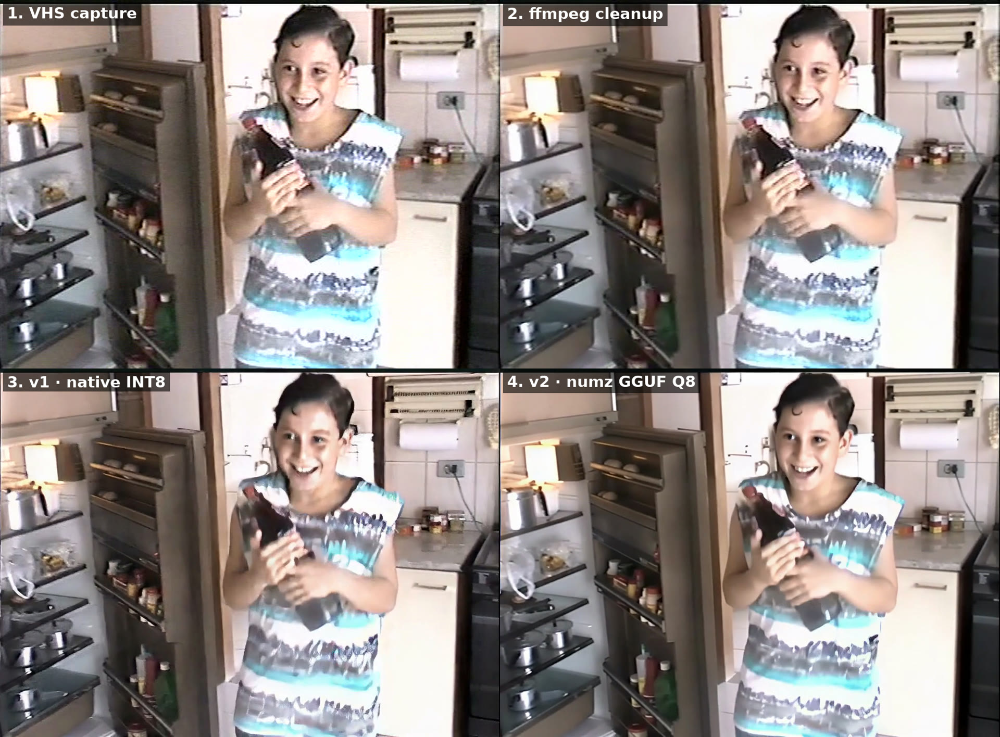
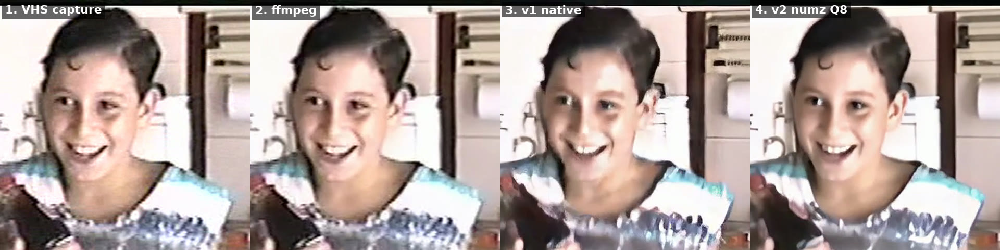

# VHS tape restoration v2

[comfyui-workflows](../../README.md) › **VHS tape restoration v2**

Same script as [v1](../vhs-upscale/README.md) (same ffmpeg cleanup, options and output), with a different upscale: instead
of ComfyUI's native SeedVR2 (INT8), v2 uses numz's
[ComfyUI-SeedVR2_VideoUpscaler](https://github.com/numz/ComfyUI-SeedVR2_VideoUpscaler) custom node with the same
SeedVR2 3B model in **GGUF Q8_0**. On the same clip it was **~3x faster** and, by eye, as good or better than v1.
v1 stays as it is, for ComfyUI installs without custom nodes.

| | |
|---|---|
| Status | ✅ tested |
| Script | [`restore_vhs.py`](restore_vhs.py) (Python 3, no extra packages) |
| Workflow used | [SeedVR2 v2 · video upscale (GGUF)](../../workflows/42-seedvr2-upscale-v2/README.md) ([`seedvr2_v2.api.json`](seedvr2_v2.api.json)) |
| Cleanup only | ~1.7× the video length on the CPU (ffmpeg), same as v1 |
| Cleanup + 720p upscale (3B) | ~45–65× the video length on the GPU: **~50 min per minute of tape** (v1: ~2 h) |
| Test | DVD-style MPEG-2 captures (720x480 NTSC, 4:3), RTX 5060 Ti 16 GB, 2026-10-26 |

## Result

Same frame and same cleaned input (`--start 0.3 -t 3`, `normalize` color, 720p):

1. **VHS capture**: the original DVD capture, only cropped like the others and resized to the same size;
2. **ffmpeg cleanup** (`--upscale none`);
3. **v1**: ComfyUI's native SeedVR2 3B INT8 (~410 s);
4. **v2**: numz custom node, SeedVR2 3B GGUF Q8_0 (134 s).





## Files in this folder

| File | What it is |
|---|---|
| `restore_vhs.py` | The script |
| `seedvr2_v2.api.json` | SeedVR2 v2 workflow (API format) that the script fills in and sends to ComfyUI |
| `seedvr2_v2.json` | Same workflow to drag into the ComfyUI interface |
| `usecase.json` | Source of this use case's row in the main README |
| `assets/` | Comparison images above |

## Requirements

- **ffmpeg** 6 or newer (`ffmpeg`/`ffprobe` in the `PATH`) and Python 3.8+.
- For the upscale: ComfyUI with the numz custom node and the GGUF model. Install them with the
  [SeedVR2 v2 workflow's `install.sh`](../../workflows/42-seedvr2-upscale-v2/README.md#installation) (3B Q8_0 +
  VAE, 4.2 GB), then `pip install rotary-embedding-torch==0.9.1` in ComfyUI's Python and restart ComfyUI.
  `--model 7b` needs `seedvr2_ema_7b-Q8_0.gguf` (8.8 GB, link in that README).
- Talking to ComfyUI works as in v1: HTTP API only, `COMFY_URL` (default `http://localhost:8188`) and the optional
  `COMFY_CONTAINER` to delete used chunks.
- Without ComfyUI, `--upscale none` still does the whole ffmpeg cleanup.

## How to use

Same commands and options as [v1](../vhs-upscale/README.md#how-to-use):

```bash
python3 restore_vhs.py birthday*.mpg                  # cleanup + 720p upscale with the 3B model (defaults)
python3 restore_vhs.py birthday*.mpg -t 5             # quick test: only the first 5 s of each video
python3 restore_vhs.py -r ~/tapes -o ~/restored       # every video in a folder and its subfolders
python3 restore_vhs.py a.mpg --upscale none           # ffmpeg cleanup only (fast)
python3 restore_vhs.py a.mpg --color mild --upscale 1080 --model 7b
```

## What changes from v1

Only step 4 (upscale). The workflow sent to ComfyUI is `LoadVideo` → `SeedVR2LoadDiTModel` (GGUF) +
`SeedVR2LoadVAEModel` → `SeedVR2VideoUpscaler` → `SaveVideo`, with:

- `resolution` = 720 or 1080 (the shortest edge; the node keeps the aspect ratio);
- `batch_size` 21 (frames processed together; 4n+1);
- `lab` color correction (keeps the colors from the ffmpeg cleanup);
- VAE tiled in 512 px tiles.

The rest is the same as v1: chunks of 601 frames (~20 s) at 720p or 181 (~6 s) at 1080p padded to 4n+1 and checked frame by frame, joined with the treated audio.

## Tests

**v1 vs v2, upscale only** (same 3 s of the raw capture, 720p, `lab`):

| Version | Time | Peak VRAM |
|---|---|---|
| v1 native 3B INT8 | 411 s | 7.0 GB |
| v2 3B Q8_0 | 150 s | 8.1 GB |
| v2 3B Q4_K_M | 148 s | 8.0 GB |
| v2 3B Q8_0, `batch_size` 93 | out of VRAM | — |
| v2 3B Q8_0, `batch_size` 93, `blocks_to_swap` 16 | 142 s | 15.6 GB |

By eye Q4 and Q8 came out the same; Q8 is the default because it is closest to the original weights. Bigger batches gave
no visible gain, and no version had a jump between batches.

**Clean before or after the upscale?** Same 3 s, v2 3B Q8_0, sharpness as the Laplacian variance (whole frame / face):

| Order | Whole frame | Face |
|---|---|---|
| raw capture, no cleanup | 106 | 70 |
| **full ffmpeg cleanup before (what the script does)** | **174** | **106** |
| crop only before | 136 | 73 |
| crop + color before | 141 | 73 |
| full cleanup after the upscale | 104 | 69 |
| color only after the upscale | 108 | 74 |

Cleaning before gives the model a cleaner signal and it rebuilds more detail; cleaning after only takes away. It was also
the version picked by eye.

**Full script:**

| Test | Result | GPU time | Peak VRAM | Min free RAM |
|---|---|---|---|---|
| whole capture (10 s, 313 frames), 3B 720p | 313 frames + audio | 696 s | 14.5 GB | not measured |
| 22 s (660 frames, 2 chunks), 3B 720p | 660 frames + audio | 983 s | 15.6 GB | 2.2 GB |
| whole capture, 3B 1080p, 301-frame chunks | 313 frames + audio | 1059 s | 15.6 GB | **0.3 GB** |
| 7 s (210 frames, chunks of 181 + 29), 3B 1080p | 210 frames + audio, no jump at the seam | 705 s | 11.7 GB | 5.6 GB |
| 3 s, 7B 720p | 90 frames + audio | 160 s | 12.1 GB | 3.9 GB |
| 3 s, 7B 1080p | 90 frames + audio | 347 s | 15.4 GB | 4.1 GB |

With 301-frame chunks at 1080p the host almost ran out of RAM, so 1080p now uses 181-frame (~6 s) chunks. The 7B came
out softer than the 3B (sharpness 108 against 174 on the same clip), as in v1, so **3B, 720p** stays the default.

## Limitations

- **Time.** ~50 min of GPU per minute of tape at 720p and ~1h40 at 1080p: still long for whole tapes. Use `-t`/`--start` to try a section first.
- **Memory.** Each chunk is held in ComfyUI's RAM. The tests ran with ~9 GB of free RAM on the host; with less, lower the chunk size with `RESTORE_VHS_CHUNK_FRAMES` (always 4n+1, e.g. 301 or 181).
- Faces with motion blur can get made-up texture in a few frames (as in v1).
- Each chunk is upscaled on its own; a small jump between chunks is possible.
- Depends on a third-party custom node: a ComfyUI update may break it (v1 does not have this risk).
- What the capture already lost (field motion, tracking errors, color bleed baked in) cannot be recovered.
