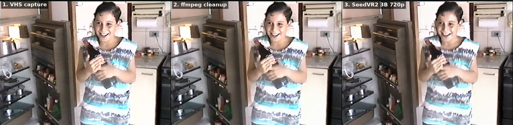
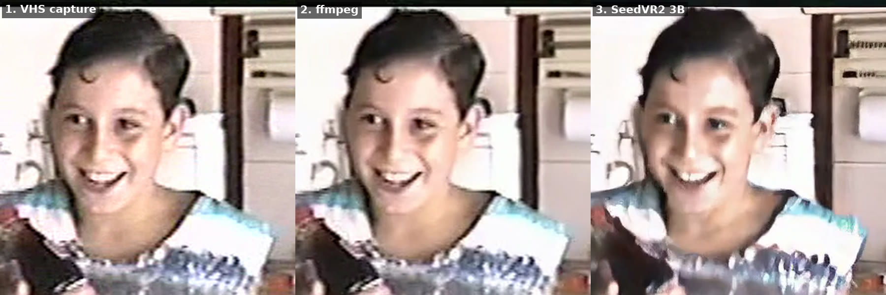

# VHS tape restoration

[comfyui-workflows](../../README.md) › **VHS tape restoration**

Batch restoration of old home videos captured from VHS (and other old formats): `restore_vhs.py` cleans each file with
ffmpeg (borders, compression blocks, noise, color, audio), sends the cleaned video to ComfyUI for a **SeedVR2** upscale
in chunks, joins everything back with the processed audio and saves a modern MP4. The original is never modified.

| | |
|---|---|
| Status | ✅ tested |
| Script | [`restore_vhs.py`](restore_vhs.py) (Python 3, no extra packages) |
| Workflows used | [SeedVR2 · 4x upscale](../../workflows/42-seedvr2-upscale/README.md) (models); ComfyUI's official SeedVR2 video template ([`seedvr2_video.api.json`](seedvr2_video.api.json)) |
| Cleanup only | ~1.7× the video length on the CPU (ffmpeg) |
| Cleanup + 720p upscale (3B) | ~110–130× the video length on the GPU: **~2 h per minute of tape** |
| Test | two DVD-style MPEG-2 captures (720x480 NTSC, 4:3, 9–10 s), RTX 5060 Ti 16 GB, 2026-10-25 |

## Result

Same frame of a home video from the 1990s, generated by the script with its defaults:

1. **VHS capture**: the original DVD capture of the tape, only cropped like the others and resized to the same size;
2. **ffmpeg cleanup**: borders, compression blocks, noise and `normalize` color (`--upscale none`);
3. **SeedVR2 3B 720p**: the final output.





## Files in this folder

| File | What it is |
|---|---|
| `restore_vhs.py` | The script |
| `seedvr2_video.api.json` | SeedVR2 video workflow (API format) that the script fills in and sends to ComfyUI |
| `seedvr2_video.json` | Same workflow to drag into the ComfyUI interface |
| `usecase.json` | Source of this use case's row in the main README |
| `assets/` | Comparison images above |

## Requirements

- **ffmpeg** 6 or newer (`ffmpeg`/`ffprobe` in the `PATH`) and Python 3.8+.
- For the upscale: ComfyUI with the SeedVR2 models. Install them with the
  [SeedVR2 workflow's `install.sh`](../../workflows/42-seedvr2-upscale/README.md#installation)
  (3B, 3.5 GB). The 7B models are optional and documented at the end of that README.
- The script copies files into ComfyUI with `docker cp`/`docker exec`. Defaults match a container named `comfyui`;
  change them with `COMFY_URL` (default `http://localhost:8188`), `COMFY_CONTAINER` (default `comfyui`) and
  `COMFY_OUTPUT` (ComfyUI's output folder on the host, default `/opt/appdata/comfyui/output`).
- Without ComfyUI, `--upscale none` still does the whole ffmpeg cleanup.

## How to use

```bash
python3 restore_vhs.py birthday*.mpg                  # cleanup + 720p upscale with the 3B model (defaults)
python3 restore_vhs.py birthday*.mpg -t 5             # quick test: only the first 5 s of each video
python3 restore_vhs.py -r ~/tapes -o ~/restored       # every video in a folder and its subfolders
python3 restore_vhs.py a.mpg --upscale none           # ffmpeg cleanup only (fast)
python3 restore_vhs.py a.mpg --color mild --upscale 1080 --model 7b
```

Output: `<output folder>/<name>_restored.mp4` (H.264 + AAC). Files that already exist are skipped (`--overwrite` redoes them).
If an input is a folder and `-r` is missing, the script says so and skips it. Quoted wildcards are expanded by the script.

| Option | Values | Default |
|---|---|---|
| `-o`, `--output` | output folder | `./restored` |
| `-r`, `--recursive` | process folders, including subfolders | off |
| `--color` | `normalize`, `mild`, `strong`, `auto`, `auto45`, `colorcorrect`, `none` | `normalize` |
| `--upscale` | `720`, `1080`, `none` | `720` |
| `--model` | `3b`, `7b` | `3b` |
| `-t`, `--max` | maximum length of each video, in seconds | the whole video |
| `--start` | start at this second | `0` |
| `--overwrite` | redo existing outputs | off |
| `--keep-temp` | keep intermediate files (useful when something fails) | off |

### Color options

| Option | ffmpeg filter | When to use |
|---|---|---|
| `normalize` | `normalize` at 70% strength, smoothed over time | **Default.** Removes most of a color cast without killing warm light; barely touches videos that are already fine |
| `mild` | `colortemperature` 8500 K, 60% | Indoor scenes under incandescent light (yellow/orange) |
| `strong` | `colortemperature` 10000 K, 70% | Very yellow footage |
| `auto` | `grayworld` | Rarely: in warm scenes it turns skin and walls green/blue |
| `auto45` | `grayworld` blended at 45% | A gentler `auto` |
| `colorcorrect` | `colorcorrect=analyze=median` | Rarely: turned one of the test scenes blue |
| `none` | — | Keep the original colors |

## What the script does

1. **Reads the file** (`ffprobe`): resolution, pixel aspect ratio (DVD captures have non-square pixels), codec, audio.
   ffmpeg reads practically any old format: `.mpg`, `.vob`, `.avi`, `.dv`, `.wmv`, `.mov`, `.3gp`…
2. **Measures the video**:
   - black borders (`cropdetect`) plus 2 px on each side for the ragged VHS edge and, on SD captures, the 12 bottom
     lines with the **head-switching noise**;
   - interlacing (`idet`): it only deinterlaces (`bwdif`, to 50/60p) when more than 25% of the frames are interlaced.
     Both test captures were flagged as interlaced in the file but were 97% progressive (the capture device had already
     merged the fields), so deinterlacing them would only blur them.
3. **Cleans up** with ffmpeg: crop, `deblock` (only for MPEG-1/2/4 and WMV sources), `nlmeans` denoise, color, scale to
   square pixels; audio: 60 Hz high-pass (hum), `afftdn` (tape hiss), `loudnorm` (one test video was 10 dB quieter).
4. **Upscales** with SeedVR2 through ComfyUI (official video template, `lab` color correction so the colors from step 3
   are kept, automatic temporal chunks to fit the VRAM). ComfyUI loads the whole clip into RAM, so long videos go in
   chunks of 601 frames (~20 s) at 720p or 301 (~10 s) at 1080p.
   SeedVR2 only returns every frame when it gets 4n+1 frames, so the last chunk is padded with copies of its last frame,
   trimmed back afterwards, and the frame count of every chunk is checked: the picture stays in sync with the audio.
5. **Joins** the chunks with the audio from step 3 into an H.264 + AAC MP4 (`+faststart`, plays anywhere).

## Tests and decisions

**Color.** Four corrections were compared on two frames of each video. ffmpeg's `grayworld` fixed the daylight video
but turned the incandescent-lit one green; `colorcorrect` turned one scene blue; `normalize` came out closest to the
correction picked by eye, so it is the default. A vision LLM (Qwen 3.8 Flash) was also asked to rank the versions,
shuffled and with neutral labels, 9 times: it always ranked the green version last, but its first choice followed the
**position** of the image (slot D in 6 of 9 runs), not the colors. It is not used to choose.

**Upscale.** Same 3 s (89 frames), 640x480 → 960x720, all with SeedVR2 settings from the official template:

| Version | Sharpness (Laplacian variance) | Time | Peak VRAM | Faces |
|---|---|---|---|---|
| input (lanczos) | 65 | — | — | — |
| **SeedVR2 3B** | **221** | 329 s | 7.5 GB | faithful |
| SeedVR2 7B | 119 | 392 s | 10.8 GB | faithful, softer |
| SeedVR2 7B *sharp* | 109 | 438 s | 10.9 GB | faithful, softer |
| Wan 2.2 5B, video-to-video at 0.3 | 75 | 273 s | 14.3 GB | **becomes someone else** |
| 3B twice (720p) | — | 329 + 354 s | 7.5 GB | sharper, but hard outlines and made-up shadows |

On a source this degraded, the 7B models keep the blur instead of rebuilding it, and re-rendering with a video
generation model (Wan 2.2) adds texture by changing the people. **3B, one pass, 720p** is the default; 1080p looks the
same (VHS has ~250 lines of real detail) and costs ~1.5× more.

**Full script:** 3 s of a capture with cleanup + 720p upscale took 391 s end to end (380 s in ComfyUI). Chunk joining was
tested by forcing 41-frame chunks (`RESTORE_VHS_CHUNK_FRAMES=41`): 90 frames in 3 chunks, the last one padded, came
out as exactly 90 frames in 467 s. The first version lost frames (SeedVR2 with a non-4n+1 chunk, and `-shortest` in
the final join); the script now checks the frame count of every chunk and of the final video.

## Limitations

- **Time.** ~2 h of GPU per minute of tape at 720p: whole tapes take days. Use `-t`/`--start` to try a section first,
  and keep the upscale for the moments that matter (`--upscale none` for the rest).
- Faces with motion blur can get made-up texture (odd eyes, aged skin) in a few frames.
- Each chunk is upscaled on its own; a small jump between chunks (every ~20 s) is possible.
- What the capture already lost (field motion, tracking errors, color bleed baked in) cannot be recovered.
- The script must run on the ComfyUI machine (it uses `docker cp` and reads ComfyUI's output folder).
